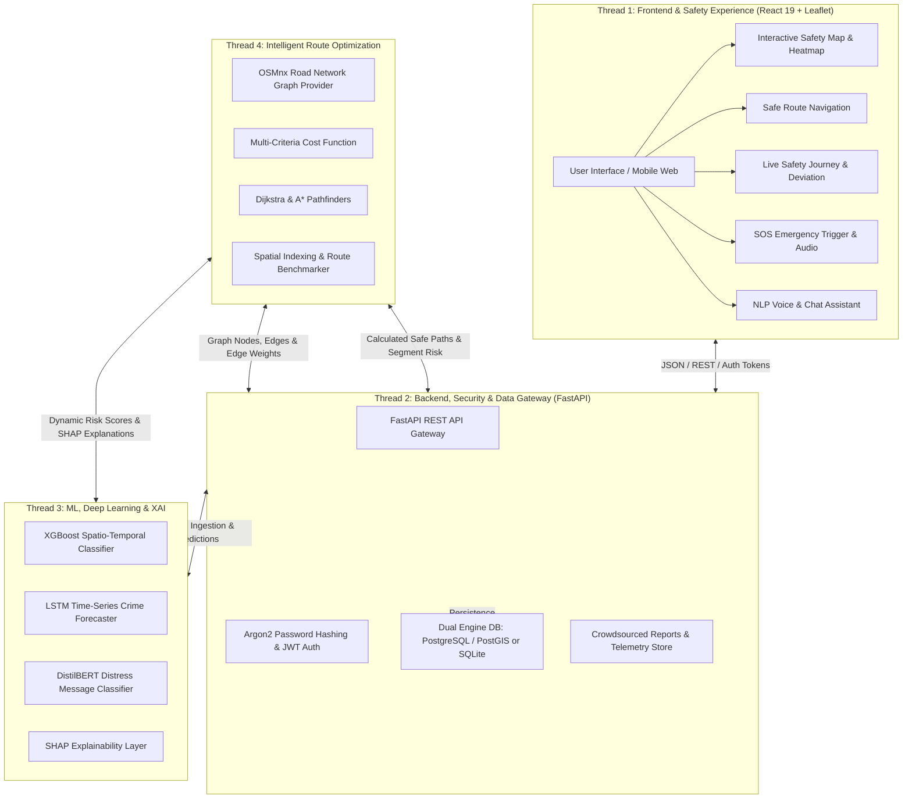

# 🛡️ NARI-KAVACH (NariShield AI)
### *AI-Driven Women's Safety, Intelligent Route Risk Prediction & Emergency Response Ecosystem*

[](https://fastapi.tiangolo.com/)
[](https://react.dev/)
[](https://vitejs.dev/)
[](https://www.python.org/)
[](https://www.postgresql.org/)
[](https://www.docker.com/)
[](#contributors)

---

## 📖 Executive Summary

**NARI-KAVACH** (also engineered under the **NariShield AI** framework) is a comprehensive, life-critical women's safety ecosystem designed to eliminate unsafe commutes, accelerate emergency responses, and provide transparent, data-driven security intelligence. 

Traditional navigation platforms optimize strictly for shortest travel time or minimal distance, often routing pedestrians through isolated, unlit, or historically hazardous corridors. NARI-KAVACH bridges this critical gap by fusing:
1. **Dynamic Spatio-Temporal Risk Prediction** powered by machine learning (XGBoost, Random Forest).
2. **Longitudinal Time-Series Crime Forecasting** using recurrent neural networks (LSTM).
3. **Natural Language Distress Classification** via fine-tuned Transformer models (DistilBERT).
4. **Explainable AI (XAI)** decomposing risk assessments using SHAP (Shapley Additive exPlanations).
5. **Algorithmic Graph Routing Engine** optimizing multi-objective cost functions across real-world road networks using Dijkstra and A* pathfinding.
6. **Active Safety Journey & Emergency SOS Protocol** providing live waypoint telemetry, route deviation alarms, and instant multi-channel alerts to trusted contacts.

---

## 🏛️ System Architecture

NARI-KAVACH operates as a synchronized four-thread collaborative engineering architecture:



---

## ✨ Key Features & Functional Modules

### 1. 🗺️ Interactive Safety Map & Spatio-Temporal Crime Heatmap
- **Visual Risk Layers:** Real-time heatmaps powered by `leaflet.heat` displaying validated crime incidence rates and high-risk zones across metropolitan coordinates.
- **Dynamic Incident Filtering:** Filter visualized zones by incident type (e.g., Harassment, Poor Lighting, Isolated Stretches, Thefts).
- **Crowdsourced Safety Reporting:** Users can submit timestamped and geo-tagged safety hazards, dynamically updating local risk weightings.

### 2. 🧭 Risk-Aware Intelligent Route Engine
- **Graph Topology:** Builds road graphs using OpenStreetMap data via OSMnx with intersections as nodes and street segments as edges.
- **Custom Multi-Objective Edge Cost Function:**
  $$\text{Cost}(e) = \alpha \cdot \frac{\text{Distance}(e)}{\text{Max Distance}} + \beta \cdot \text{Risk}(e)$$
- **User-Defined Routing Preferences:**
  - 🛡️ **Safety Priority:** $\alpha = 0.2, \beta = 0.8$ (Strictly avoids hazardous nodes regardless of length).
  - ⚖️ **Balanced Route:** $\alpha = 0.5, \beta = 0.5$ (Optimal trade-off between detour length and safety).
  - ⚡ **Time Priority:** $\alpha = 0.8, \beta = 0.2$ (Direct shortest path).
- **Segment-Level Risk Breakdown:** Every edge is scored and color-coded into **Low (Green)**, **Medium (Yellow)**, or **High (Red)** risk categories.
- **Live Handoff & Turn-by-Turn Telemetry:** Seamlessly switch from route planning to active navigation.

### 3. 🚨 Live Safety Journey & Emergency SOS
- **Real-Time Waypoint Tracking:** Monitors user GPS updates against planned route coordinates.
- **Automated Route Deviation Detection:** Triggers audible and visual warnings when the user diverges beyond a defined geodesic threshold, prompting route recalculation or emergency confirmation.
- **One-Click SOS Dispatch:** Instant alert broadcast containing live GPS coordinates, battery status, and timestamp to registered trusted contacts.
- **Evidence Audio Recorder:** Capture ambient audio clips during suspicious situations for post-incident review.

### 4. 🤖 Machine Learning, Deep Learning & Explainable AI
- **Multi-Factor Risk Prediction:** Evaluates hour of day, day of week, proximity to police stations/hospitals, street illumination score, weather conditions, and community reports.
- **LSTM Crime Forecasting:** Anticipates monthly and seasonal trend progressions trained on longitudinal NCRB datasets.
- **DistilBERT Distress NLP:** Parses incoming text, voice transcripts, or emergency notes into *Normal*, *Suspicious*, *Harassment*, or *Emergency* states.
- **Explainable AI (SHAP):** Decomposes complex model outputs into human-understandable explanations (e.g., *"Risk score elevated due to poor street lighting (0.2/1.0) and late hour (23:00)"*).

---

## 📊 Scientific Benchmarks & Model Evaluation

### Machine Learning Classification Performance
Trained on official National Crime Records Bureau (NCRB) datasets and urban telemetry:

| Model | Accuracy | Macro Precision | Macro Recall | Macro F1 | High Risk Recall | ROC-AUC (OVR) |
| :--- | :---: | :---: | :---: | :---: | :---: | :---: |
| **XGBoost (Selected)** | **88.13%** | **0.8737** | **0.8490** | **0.8606** | **0.7742** | **0.9707** |
| Random Forest | 87.73% | 0.9171 | 0.7669 | 0.8161 | 0.5161 | 0.9697 |
| Logistic Regression | 80.67% | 0.7116 | 0.8386 | 0.7496 | 0.9032 | 0.9362 |

### NLP Distress Message Classification (DistilBERT)
- **Model Architecture:** Fine-Tuned HuggingFace `distilbert-base-uncased`
- **Validation Accuracy:** **96.88%**
- **Macro F1-Score:** **0.9686**
- **Safety Policy:** Operates under strict **Human-in-the-Loop** confirmation (`requires_user_confirmation: true`). No autonomous emergency dialing occurs without human consent.

### Explainable AI Feature Attribution (Mean $|SHAP|$)
1. **Historical Crime Rate:** $2.2439$
2. **Street Lighting Score:** $1.4030$
3. **Hour of Day:** $1.0970$
4. **Recent Community Reports:** $0.5546$
5. **Distance to Police Station (km):** $0.5203$
6. **Distance to Hospital (km):** $0.1433$

### Algorithmic Route Engine Benchmarking (Dijkstra vs. A*)
Empirical results across synthetic and real-world topological grid benchmarks:

| Grid Topology | Total Nodes | Algorithm | Latency (ms) | Explored Nodes | Optimality Guarantee |
| :---: | :---: | :---: | :---: | :---: | :---: |
| **10 × 10** | 100 | Dijkstra | 0.082 ms | 100 | Exact Global Minimum |
| **10 × 10** | 100 | A* (Haversine) | 0.162 ms | 91 | Exact Global Minimum |
| **25 × 25** | 625 | Dijkstra | 0.767 ms | 625 | Exact Global Minimum |
| **25 × 25** | 625 | A* (Haversine) | 1.215 ms | 601 | Exact Global Minimum |
| **50 × 50** | 2,500 | Dijkstra | 2.854 ms | 2,500 | Exact Global Minimum |
| **50 × 50** | 2,500 | A* (Haversine) | 5.455 ms | 2,451 | Exact Global Minimum |

---

## 💻 Tech Stack & Libraries

| Domain | Technologies & Libraries |
| :--- | :--- |
| **Frontend** | React 19, Vite 8, React-Leaflet, Leaflet Heat, Lucide Icons, Modern CSS3 |
| **Backend** | Python 3.12+, FastAPI, Uvicorn, SQLAlchemy ORM, Pydantic, GeoAlchemy2 |
| **Database** | PostgreSQL / PostGIS (Production), SQLite with automatic fallback (Local Dev) |
| **Security** | Argon2 (`pwdlib`), JWT Bearer Tokens (`python-jose`), 2-Hour Idle Session Timeout |
| **Machine Learning** | Scikit-Learn, XGBoost, SHAP, PyTorch, HuggingFace Transformers (`distilbert-base-uncased`) |
| **Route & Graph Engine** | OSMnx, NetworkX, Shapely, NumPy, Pandas |
| **DevOps & Cloud** | Docker, Railway (`railway.json`), Vercel (`vercel.json`) |

---

## 📁 Repository Directory Structure

```text
NARI-KAVACH/
├── Backend/
│   ├── app/
│   │   ├── core/              # Config, security, JWT dependencies
│   │   ├── database/          # Connection pooling, SQLite/PostgreSQL engine
│   │   ├── models/            # SQLAlchemy database models
│   │   ├── routers/           # REST endpoints (auth, routes, emergency, journey, etc.)
│   │   ├── schemas/           # Pydantic validation schemas
│   │   └── main.py            # FastAPI entry point & CORS configuration
│   ├── route_engine/          # Packaged internal routing engine
│   ├── Dockerfile             # Multi-stage production container build
│   ├── Procfile               # Cloud deployment process declaration
│   ├── railway.json           # Railway cloud configuration
│   └── requirements.txt       # Backend dependencies
├── Frontend/
│   ├── src/
│   │   ├── AlertHistory.jsx   # SOS alert audit log
│   │   ├── Analytics.jsx      # Safety risk analytics dashboard
│   │   ├── App.jsx            # Core layout, sidebar navigation, auth session state
│   │   ├── Contacts.jsx       # Emergency contact management
│   │   ├── Emergency.jsx      # SOS triggers, helpline access & voice assistant
│   │   ├── LocationTracker.jsx# GPS telemetry updater
│   │   ├── Login.jsx          # Secure authentication portal
│   │   ├── NLPAssistant.jsx   # Natural language safety interaction
│   │   ├── Profile.jsx        # User account & preferences
│   │   ├── SafeRoute.jsx      # Multi-preference route search & navigation
│   │   ├── SafetyMap.jsx      # Leaflet crime heatmap & incident reporting
│   │   ├── SOSButton.jsx      # Persistent rapid emergency trigger
│   │   └── apiConfig.js       # Dynamic API host URL resolution
│   ├── package.json           # Node dependencies & Vite scripts
│   └── vercel.json            # Vercel Single Page Application rewrite rules
├── ML/
│   ├── data/                  # NCRB historical datasets & processed records
│   ├── models/                # Serialized XGBoost, LSTM & NLP weights
│   ├── reports/               # SHAP values, benchmark metrics, evaluation plots
│   └── train_all.py           # End-to-end model training pipeline
├── route_engine/
│   ├── algorithms/            # Dijkstra & A* pathfinders
│   ├── benchmarks/            # Algorithmic performance profiling
│   ├── graph/                 # Graph, Node, and Edge primitives
│   ├── risk/                  # Dynamic risk adapter
│   └── road_network/          # OSMnx OpenStreetMap ingestion
├── start_servers.bat          # Automated dual-server development launcher
├── requirements.txt           # Unified workspace Python dependencies
└── README.md                  # Project documentation
```

---

## 🚀 Getting Started & Local Setup

### Prerequisites
- **Git**
- **Python 3.10+** (Python 3.12 recommended)
- **Node.js 18+** & **npm**
- *(Optional)* PostgreSQL with PostGIS extension (SQLite auto-fallback is active by default)

---

### Step 1: Clone the Repository
```bash
git clone https://github.com/Madebyrishi04/NARI-KAVACH.git
cd NARI-KAVACH
```

---

### Step 2: Backend Setup

1. **Navigate to the Backend directory:**
   ```bash
   cd Backend
   ```

2. **Create and activate a virtual environment:**
   - **Windows (PowerShell):**
     ```powershell
     python -m venv .venv
     .\.venv\Scripts\Activate.ps1
     ```
   - **Linux / macOS:**
     ```bash
     python3 -m venv .venv
     source .venv/bin/activate
     ```

3. **Install dependencies:**
   ```bash
   pip install -r requirements.txt
   ```

4. **Configure Environment Variables:**
   Create a `.env` file in `Backend/` based on `.env.example`:
   ```ini
   SECRET_KEY=your_super_secret_jwt_key
   ALGORITHM=HS256
   ACCESS_TOKEN_EXPIRE_MINUTES=120

   # Optional PostgreSQL connection (if omitted, SQLite personal_safety.db will be used automatically)
   DATABASE_URL=sqlite:///./personal_safety.db
   ```

5. **Start the FastAPI backend:**
   ```bash
   uvicorn app.main:app --host 127.0.0.1 --port 8000 --reload
   ```
   - **API Server:** `http://127.0.0.1:8000`
   - **Interactive Swagger Documentation:** `http://127.0.0.1:8000/docs`
   - **ReDoc API Spec:** `http://127.0.0.1:8000/redoc`

---

### Step 3: Frontend Setup

1. **Open a new terminal and navigate to `Frontend`:**
   ```bash
   cd Frontend
   ```

2. **Install frontend dependencies:**
   ```bash
   npm install
   ```

3. **Start the Vite development server:**
   ```bash
   npm run dev
   ```
   - **Local Web Application:** `http://127.0.0.1:5173`

---

### ⚡ One-Click Startup (Windows)
For rapid local testing, execute the batch launcher from the project root:
```cmd
start_servers.bat
```
This automatically initializes both the FastAPI backend and Vite frontend in synchronized console windows.

---

## 🌐 Cloud Deployment

### Backend on Railway / Docker
A production `Dockerfile` is included at the repository root.
- The backend automatically detects the `PORT` environment variable assigned by Railway or Cloud Run.
- Health checks are exposed at `/health`.

```bash
docker build -t nari-kavach-backend .
docker run -p 8000:8000 nari-kavach-backend
```

### Frontend on Vercel
Configured via `Frontend/vercel.json` with SPA routing rewrites.
- Set environment variable `VITE_API_URL` to your production backend URL (e.g., `https://your-backend.up.railway.app`).

---

## 🛡️ Ethical AI & Safety Governance

1. **Human-in-the-Loop Safeguards:** AI predictions and distress classifications do **not** autonomously place calls to emergency telephone numbers (112 / 911). All emergency dispatches require explicit user verification or conscious SOS button triggers.
2. **Decision-Support Scope:** Route risk scores represent probabilistic estimates synthesized from historical reporting, lighting conditions, and proximity to infrastructure. The system is designed as an intelligent safety aid and does not guarantee complete absence of risk.

---

## 👥 Contributors & Work Division

Developed as part of the **Final Year Major Project (7th Semester)** by:

| Name | Roll Number | Primary Domain & Architecture Thread |
| :--- | :---: | :--- |
| **Snehangshu Sarkar** | **23052600** | **Project Lead • DSA & Routing Engine • Fullstack & Local Deployment** |
| **Anushka Anand** | **23052225** | **Backend Architecture • Database Modeling & Security Protocols** |
| **Aditya Mukherjee** | **23051156** | **Machine Learning • Deep Learning (LSTM) & Explainable AI (SHAP)** |
| **Shristi Jha** | **23052755** | **Frontend Engineering • Geospatial UI, Mapping & Safety Journey Experience** |

---

## 📜 License
This project is developed for educational and academic research purposes under the **Major Project - I (7th Semester)** curriculum. All rights reserved by the project authors.
